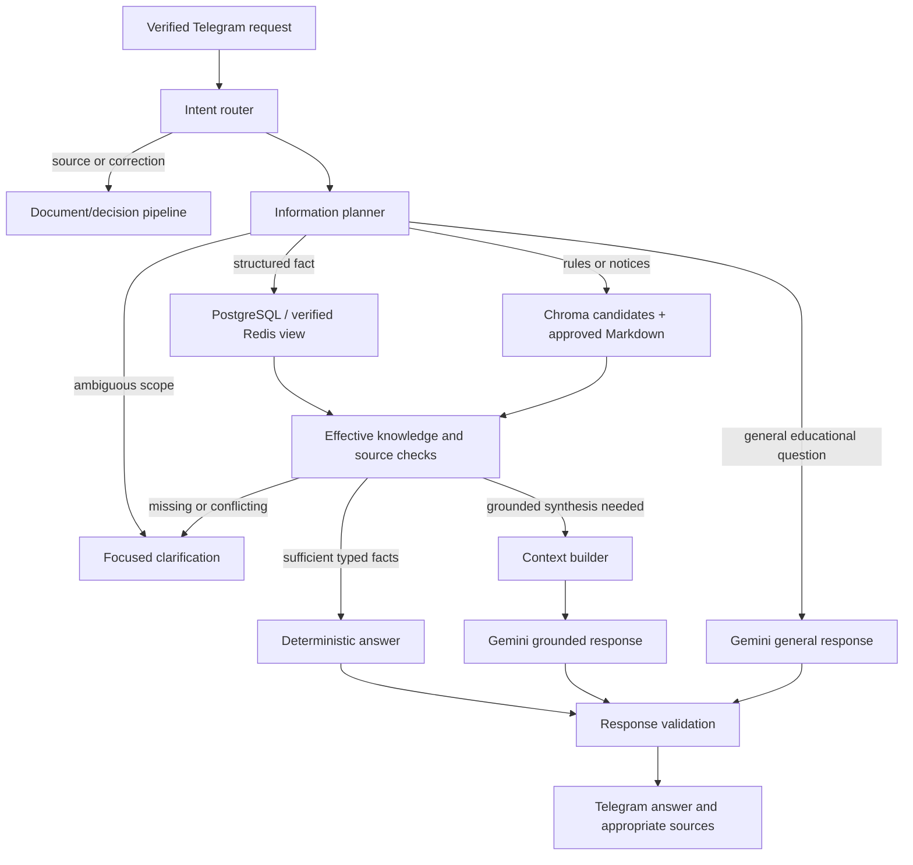

# AI Pipeline

This document owns request execution for the custom pipeline under [PROJECT_CONTEXT.md](../PROJECT_CONTEXT.md). No LangChain or autonomous agent loop. [AI_BEHAVIOR.md](AI_BEHAVIOR.md) governs responses; [KNOWLEDGE_SYSTEM.md](KNOWLEDGE_SYSTEM.md) governs knowledge eligibility; uploads follow [DOCUMENT_PROCESSING.md](DOCUMENT_PROCESSING.md).

## Flow and bounded contracts

Internal contracts are typed and versioned. They need no new public API beyond Telegram, authenticated task callbacks and Scheduler endpoints.

| Contract | Minimum fields |
| --- | --- |
| Routed request | Intent, scope/entity candidates, requested date/time, persistence intent and routing uncertainty |
| Information plan | Required fact keys, retrieval modes, effective date/scope, clock snapshot and unresolved prerequisites |
| Retrieved evidence | Fact/section values, revision/source IDs, locators, upload dates, decision references, control generation and coverage state |
| Context envelope | User question, resolved scope/time, eligible evidence, known gaps/conflicts and permitted claim/source mapping |
| Response candidate | Answer text or typed answer, claim-to-evidence references and explicit uncertainty |
| Validation result | PASS, CLARIFY, ABSTAIN or RETRY_ONCE, with safe reason codes |

Provider output cannot contain authorized SQL, Drive operations, arbitrary URLs to fetch, reminder times or executable tool calls. Application logic interprets only allowlisted typed proposals.

## Provider and model configuration

Use the free Gemini Developer API through the official `google-genai` SDK, with an unbilled project separate from infrastructure billing. No paid fallback, quota evasion or automatic upgrade. Provider identity and model IDs remain configurable; Gemini is the only implemented/approved provider. Exact model names are engineering defaults, not product requirements. [SDK](https://ai.google.dev/gemini-api/docs/libraries), [billing](https://ai.google.dev/gemini-api/docs/billing).

| Role | Initial configurable model |
| --- | --- |
| Generation, grounded synthesis, extraction and visual understanding | `gemini-3.8-flash` |
| Lightweight uncertain routing/classification | `gemini-3.5-flash-lite` |
| Structured-Markdown embeddings | `gemini-embedding-2`; dimensions/format owned by KNOWLEDGE_SYSTEM |

Use deterministic routing first. Do not automatically call both generation models or use a moving `latest` alias. Validate replacements with regression tests; re-index incompatible embeddings. Actual model/project rate limits come from AI Studio/provider responses, not fixed example quotas. Daily provider resets use Pacific time, independently of Asia/Kolkata reminder policy. [Rate limits](https://ai.google.dev/gemini-api/docs/rate-limits), [pricing baseline](https://ai.google.dev/gemini-api/docs/pricing).

Quota exhaustion preserves deterministic answers, exact-source retrieval and reminders when persistent dependencies are available. If semantic lookup needs an unavailable query embedding, use reliable metadata-directed retrieval or explain the limitation. If synthesis is unavailable, render supported facts deterministically where sufficient. Persist AI-dependent upload/index work for later execution; ordinary question bodies are not stored as durable retry jobs. Explain unavailable general generation briefly. No silent unevaluated model substitution.

## 1. Intent routing

Verify Telegram authorization before routing. Inspect explicit reply/confirmation references and deterministic patterns first. Use a small bounded Gemini routing call only when rule-based routing cannot reliably distinguish intent; uncertain material interpretation asks the user.

Core intents: NEXT_LECTURE, TIMETABLE_QUERY, EVENT_QUERY, EXAM_RULE_QUERY, NOTICE_QUERY, GENERAL_KNOWLEDGE, KNOWLEDGE_SUBMISSION, CORRECTION, CONFIRMATION, UNDO_RECOVERY and SYSTEM_CONTROL. These are internal categories, not commands the user must learn.

College-related intent is the default. A question about “the exam rules” must not be routed to a generic model answer when retrieval is empty. “Explain recursion” can use GENERAL_KNOWLEDGE. Mixed requests use evidence-backed college facts plus clearly separated general explanation; they do not transfer unsourced general claims into college knowledge.

Ambiguous persistence intent triggers a question. Ordinary messages never automatically enter document storage or embeddings. Explicit submissions/corrections and confirmed changes route to the document/decision pipeline.

## 2. Information planning

Compute what is needed before choosing storage: scope/subject, requested time, relevant fields and whether the answer requires structured facts, textual rules or both. Use supplied/confirmed profile context when applicable; ask if multiple sections or subjects remain plausible.

Read the runtime clock for relative dates or validity. Resolve today/tomorrow in Asia/Kolkata. Track event occurrence date separately from knowledge effective date. Expand recurring timetables deterministically for requested dates and evidenced exceptions.

Plans are bounded retrieval instructions, not open-ended model-generated action lists. The planner cannot decide to browse, create reminders, publish a revision or scan archives just to improve answer confidence.

## 3. Retrieval selection

| Need | Primary path | Fallback and boundary |
| --- | --- | --- |
| Next lecture, timetable, exam/deadline facts | PostgreSQL structured projections; Redis can supply a verified derived view | Requery PostgreSQL on cache miss/outage. No Gemini generation when facts can be rendered reliably. |
| Rules, notices, source-based explanations | Chroma candidate selection plus approved structured Markdown | Metadata-directed Drive retrieval for identifiable items; report incomplete/unavailable lookup if reliable coverage cannot be established. |
| Known named source/item | PostgreSQL metadata → exact Drive Markdown revision | Avoid vector lookup when exact selection suffices. |
| General educational explanation | Gemini directly | Explain provider unavailability; do not fabricate college attribution. |
| Conflict/status question | PostgreSQL decision/conflict metadata plus source evidence | Show disputed claims as disputed, outside ordinary eligible answer facts. |
| Explicit undo/recovery | Restricted history inspection and decision pipeline | History remains excluded from normal query context. |

All college paths recheck publication, lifecycle, source/artifact integrity holds, validity, override relationships and conflict masks against PostgreSQL. Fetch source filenames/upload dates from registered source metadata. A Redis entry or Chroma payload alone cannot authorize an answer.

Query Chroma only with a compatible embedding model/index generation. Filter candidate IDs through the effective-knowledge resolver before reading full context. Limit candidates by scope and content relevance; compensate for discarded stale candidates so retrieval does not falsely appear empty. Do not rely on an “active” flag inside Chroma as current truth.

Distinguish no matching evidence, ambiguous scope, incomplete extraction, indexing lag and service failure. These produce different user explanations. Missing vector hits alone do not establish absence of a college fact.

Initial retrieval default: eight usable candidates, with bounded additional retrieval when stale/masked results consume the budget. Choose and record the total scan/token bound during implementation tests; never use unbounded overfetch. Candidate count and context budgets are adjustable. Numeric similarity/abstention thresholds require labelled retrieval calibration and cannot decide authority.

## 4. Context construction

Build the smallest sufficient evidence set, keeping table headings, exceptions and rule applicability with the selected facts. Include current time where needed, source filenames/upload dates, item/revision IDs, relevant confirmed decisions and explicit unknown fields.

Exclude archived/superseded material and unresolved disputed facts from ordinary answer context. For partial overrides/conflicts, render an effective fact view instead of passing an entire Markdown body that still contains masked values. A conflict explanation gets a separate labelled comparison envelope that forbids treating either claim as resolved.

Treat all source text as quoted data isolated from system instructions. Do not include secrets, unrelated files, full chat history or entire PDFs. If context exceeds model limits, narrow by logical sections while preserving conditions; if that loses necessary evidence, clarify or report the limitation.

Transient context may identify the subject of a follow-up; it is never evidence for an unconfirmed college fact. A lost antecedent results in clarification, not retrieval of old chat logs.

## 5. Generation or deterministic rendering

Use deterministic templates for structured event answers, empty results with known coverage, conflict comparisons, processing statuses and reminders. Ordinary phrasing variation is not sufficient reason for a generation call.

Use Gemini for grounded summarization, combining applicable textual evidence, educational explanation or uncertain routing/extraction. Restrict college generation to supplied eligible evidence. Ask it to map material claims to provided source IDs and mark gaps. Generation cannot produce a persistent change on its own.

Gemini embedding calls remain necessary for semantic retrieval/indexing when no exact/structured route applies. Initial model/dimension defaults are recorded above and in KNOWLEDGE_SYSTEM; pin evaluated versions per index generation. Avoid repeating successful calls after later-stage failures.

## 6. Response validation and delivery

Validate schema, intent compliance, source references and required fields. Compare dates, times, rooms, amounts and conditions to typed evidence. Reject citations to unseen, mismatched or ineligible revisions. Verify that uncertainty and conflict labels are preserved and that a generic explanation has not become a college-specific assertion.

Recheck control generation and time eligibility before sending. If relevant state changed during generation, reconstruct the evidence and answer; never ship a known-stale response. Use bounded retries to avoid looping while state changes. At a validity boundary, use the new effective state even if generation began before the boundary.

On unsupported generated content, allow one constrained regeneration or deterministic rendering of supported facts. Otherwise abstain with a brief missing/conflicting-information explanation. Do not ask Gemini repeatedly until it emits a confident answer. Free-form entailment cannot be fully proven by string checks; representative evidence review is required in TESTING.

Safely escape Telegram markup. Split long answers at logical boundaries, preserving attribution and applicable conditions with each relevant segment; do not silently truncate a rule exception. Send only to the configured private chat. Store no permanent response transcript.

## Acceptance criteria

- Known event/timetable questions can complete without any Gemini call, including routing when intent is clear.
- General educational questions can use Gemini without inventing college sources or persisting conversation.
- No answer context contains masked, obsolete or uncommitted facts through a stale cache/index entry.
- Provider outages preserve deterministic functionality and produce honest, distinguishable failure messages.
- An unsupported claim is rejected or results in abstention, not accepted because it sounds plausible.
