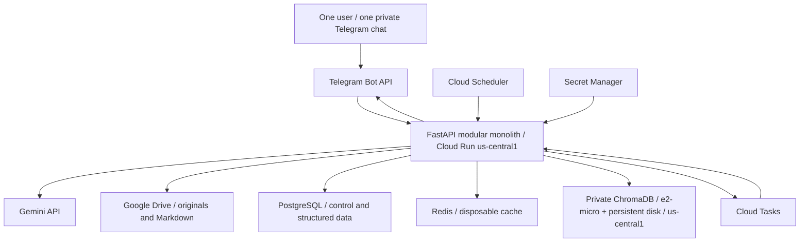

# Architecture

This document owns technical boundaries, deployment and operational recovery. [PROJECT_CONTEXT.md](../PROJECT_CONTEXT.md) governs scope and fixed choices. Domain policies remain in [DOCUMENT_RULES.md](DOCUMENT_RULES.md), not in individual storage adapters.

## System shape

One Python/FastAPI modular monolith serves Telegram webhooks, authenticated Cloud Tasks processing requests and authenticated Cloud Scheduler checks. All handlers use the same domain modules and persistent control data. Managed queues and databases are infrastructure, not separate application microservices. No LangChain, agent framework, Kubernetes or multi-user tenancy.

## Module ownership

| Module | Responsibility and boundary |
| --- | --- |
| telegram | Verify incoming identity/chat, parse transport metadata, send safely formatted responses and handle rate limits. No document-authority logic. |
| ai | Gemini adapters, prompts, typed extraction/routing proposals and output validation. No unrestricted tools or direct mutations. |
| documents | Intake, classification/extraction coordination, source persistence and resumable processing stages. |
| knowledge | Validation, publication, decisions, conflict masks, scoped overrides and the shared effective-knowledge resolver. |
| retrieval | Structured lookups, semantic candidate retrieval and verified context assembly. |
| reminders | Fixed occurrence generation, eligibility checks, delivery state and Telegram dispatch. |
| database | PostgreSQL repositories, transactions, constraints, locks and schema migrations. |
| cache | Generation-aware Redis reads/writes and persistent fallbacks. |
| scheduler | Authenticated periodic expiry, reminder and recovery checks; no in-process permanent scheduler. |
| utils | Clock, identifiers, hashing and sanitized observability helpers only; no hidden domain policy. |

## Storage ownership

| Store/service | Owns | Must not own |
| --- | --- | --- |
| Drive | Original bytes, accepted text sources, immutable Markdown revisions, backup files, sanitized log exports | Independent active-state decisions |
| PostgreSQL | Source/knowledge metadata, publication/eligibility, jobs, decisions, conflicts, events, settings, reminders and structured audit | PDFs, images, full Markdown bodies, embeddings or permanent chat transcripts |
| Redis | Rebuildable derived schedules/views and verified-content cache only | Conversation context, durable jobs, sole deduplication records or truth |
| Chroma | Embeddings of structured Markdown, candidate metadata/excerpts | Original PDF embeddings, publication decisions or authoritative lifecycle |
| Cloud Tasks | Durable asynchronous delivery and retries | Sole processing state or a guarantee of exactly-once execution |
| Cloud Scheduler | Periodic triggering | Event truth, per-event adaptive reasoning or in-memory job ownership |

## Deployment specification

- Deploy Cloud Run backend and Chroma VM in **us-central1** initially. Cloud Run local files are temporary scratch space only; cap scratch usage and clean it after requests.
- Run one Chroma server on a Google Compute Engine **e2-micro** VM with a persistent **pd-standard** disk. Keep boot/data allocation within the intended free-tier disk allowance where practical; validate the total before provisioning. Retain disk data across container restarts. Do not host PostgreSQL or Redis on this memory-constrained Chroma VM by assumption.
- Use private VM connectivity from Cloud Run through Direct VPC egress and restricted firewall rules. Do not expose the Chroma port publicly. Configure TLS for the client connection, with a small VM-local proxy if the pinned Chroma release needs one; administrative access is restricted.
- Store API tokens and Drive credentials in Secret Manager; give runtime identities least-privilege access. Use a dedicated queue/Scheduler invoker identity and validate OIDC issuer, audience and permitted identity on internal routes.
- Telegram requires a publicly reachable webhook. If internal routes share that Cloud Run service, enforce OIDC verification in the application on every internal route; service-level public ingress is not internal authorization. Verify Telegram's webhook secret and configured sender/chat independently.
- Use Cloud Tasks in us-central1. Jobs are divided into bounded stages that finish inside configured dispatch and Cloud Run request deadlines. Do not keep a request open for an unbounded whole-document pipeline.
- Cloud Scheduler uses exactly the three jobs specified below. Obtain actual current time inside handlers; repeated/late invocations do not change reminder policy.
- Use **Aiven Free PostgreSQL** through authenticated public TLS with `sslmode=verify-full` and the provider CA certificate. Use SQLAlchemy 2, Psycopg 3 and Alembic; pin compatible package versions during implementation. The free service has 1 GB disk, 20 connections, no provider pooling and no SLA. Its inactivity policy can power off unused services; validate recovery rather than assuming automatic wake-up. Minute-based legitimate checks make Neon's free monthly compute allowance unsuitable for this workload. [Aiven free limits](https://aiven.io/docs/products/postgresql/concepts/pg-free-tier), [Aiven TLS](https://aiven.io/docs/platform/concepts/tls-ssl-certificates).
- Use **Upstash Free Redis**, `redis-py` asynchronous client and verified authenticated public TLS for derived cache only. Prefer one GCP us-central1 primary without additional read replicas where available on the free plan. No automatic paid upgrade. PostgreSQL is required for correctness; Redis is optional for availability. [Upstash pricing](https://upstash.com/pricing/redis), [regions](https://upstash.com/docs/redis/features/globaldatabase).

Configure Direct VPC egress with private-range routing for Chroma while preserving ordinary outbound access to Aiven, Upstash, Telegram, Drive and Gemini. Use no paid VPC connector or Cloud NAT and no external IPv4 on the VM. Validate Private Google Access for image pulls and an operational OS-update path without public Chroma exposure. [Direct VPC egress](https://docs.cloud.google.com/run/docs/configuring/vpc-direct-vpc), [Private Google Access](https://docs.cloud.google.com/vpc/docs/configure-private-google-access).

Upstash persistence is always enabled. Store no temporary conversation context there: use bounded process memory exclusively, accepting loss on instance changes. Never include it in logs or backups. Derived cache persistence does not confer authority; no application Redis backup is required. [Upstash durability](https://upstash.com/docs/redis/features/durability).

The approved e2-micro has 1 GB RAM and 0.25 fractional vCPU. Chroma's published guidance recommends at least 2 GB, so adequate capacity is an **early benchmark gate**, not an established fact. Test before vector-dependent implementation. Use a minimal server container, no local embedding model, one indexing operation at a time and `chromadb-client` in the backend. Measure the chosen release, TLS overhead, restart, ingestion, query and rebuild memory with growth headroom; do not assume raw vector size predicts resident memory or that swap fixes inadequate RAM. If it fails, stop dependent work and obtain approval before changing machine type, scope or cost. [Chroma guidance](https://docs.trychroma.com/production/administration/performance), [thin client](https://docs.trychroma.com/guides/performance).

Google lists an eligible e2-micro allowance in us-central1 with standard-disk limits. That does not establish zero cost for the full system, networking, databases, Gemini, backup traffic or logs. Check account eligibility, quotas and current pricing before provisioning. [Google Cloud Free Tier](https://docs.cloud.google.com/free/docs/free-cloud-features), [E2 machine specifications](https://docs.cloud.google.com/compute/docs/general-purpose-machines).

## Cost target and engineering defaults

Initial deployment targets **zero monetary cost**, without a zero-cost guarantee. No silent paid services/upgrades/fallback. Keep Gemini free-only in a separate unbilled project; infrastructure may require a billing-enabled project. Provider/model identifiers are configuration, not product constants; Gemini is the sole approved provider. AI_PIPELINE owns initial model assignments and quota degradation.

The following defaults are adjustable after measurement; fixed reminder/authority/privacy rules are not tuning parameters.

| Setting | Initial default |
| --- | --- |
| Cloud Run billing and scale | Request-based; minimum 0, maximum 2 instances |
| Instance resources | 1 vCPU, 1 GiB RAM; concurrency 4 |
| Heavy document work | One active stage globally, enforced by PostgreSQL leases; queue concurrency alone does not cover manual/recovery dispatch |
| Deadlines | Application stage 240 s; Cloud Tasks 300 s; Cloud Run request 360 s |
| PostgreSQL pool | Two connections per instance, zero overflow, health checks; include rollout overlap/admin/backup connections under the provider limit |
| Redis operation timeout | 500 ms; prompt persistent fallback |
| Derived cache TTL | Five minutes, additionally capped by validity transitions and checked against control generation |
| Logs | Sanitized operational logs retained 30 days; preserve durable decision/publication audit separately |
| Transport metadata | Seven-day deduplication horizon; durable source/job/reminder identity remains |

Cloud Run scratch storage consumes memory; bound it together with decoded images, parser allocations and concurrent requests. Deadlines require application cancellation/checkpoints and leases: a disconnected task request does not guarantee the handler stopped. Pin exact dependency versions and image digests after compatibility tests.

Research baseline, 02 October 2026: Cloud Run request-based free allowances are 2 million requests, 180,000 vCPU-seconds and 360,000 GB-seconds/month; eligible Compute Engine allowance is one e2-micro equivalent plus 30 GB-months standard disk. Cloud Tasks includes one million billable operations; Scheduler three jobs per billing account. Artifact Registry includes only 0.5 GiB-month storage; Secret Manager six active versions and 10,000 accesses/month. Upstash includes 256 MB, 500K commands and 10 GB bandwidth/month. Verify current account-wide availability before provisioning; do not rely on trial credits. [Tasks pricing](https://cloud.google.com/tasks/pricing), [Scheduler pricing](https://cloud.google.com/scheduler/pricing), [Artifact Registry pricing](https://cloud.google.com/artifact-registry/pricing), [Secret Manager pricing](https://cloud.google.com/secret-manager/pricing).

Measure stored container images including rollback/rollout overlap, scheduler CPU, external traffic, Drive free space, logs and secret-version rotations. Prefer local builds and few retained images. Paid private databases, connectors/NAT, external VM IPv4, disk snapshots, excess storage/egress and paid AI are not assumed costs to accept silently. Budget alerts are not a guaranteed spending cap. Validate the whole layout before deploying. [IPv4 pricing](https://cloud.google.com/vpc/pricing), [budget behaviour](https://docs.cloud.google.com/billing/docs/how-to/budgets).

## Tasks and Scheduler defaults

One document/maintenance queue in us-central1 initially: maximum one concurrent dispatch, one dispatch/second; small ID-only task payloads, deterministic hashed task names and PostgreSQL stage idempotency. Initial transport retry: five attempts including the first, minimum backoff 10 s, maximum 600 s, `maxRetryDuration=0` (duration unlimited, attempt bound retained). Do not interpret combined attempt/duration bounds as stopping when either limit is met. Application leases, stage attempt limits and final failure reconciliation remain authoritative. Additional queue settings are implementation configuration, not product behaviour. [Retry semantics](https://docs.cloud.google.com/tasks/docs/configure-retry-task?hl=en).

After persisting quota deferral as RETRY_PENDING with QUOTA_EXHAUSTED and a next-attempt time, acknowledge the task; the operational tick dispatches eligible deferred work. Respect provider retry/reset information, avoid immediate retries and never bypass quotas with other keys/projects. Invalid inputs or confirmations are not transport failures. Unexpected transport failure may return a retryable response; exhausted deliveries are reconciled from PostgreSQL. Cloud Tasks name deduplication lasts only up to 24 hours and never replaces durable application identity. [Tasks limits](https://docs.cloud.google.com/tasks/docs/quotas).

| Scheduler job | Initial schedule in Asia/Kolkata | Work |
| --- | --- | --- |
| Operational tick | Every minute | Due reminders, validity transitions, bounded outbox/lease recovery and eligible deferred jobs |
| Backup trigger | Every six hours | Enqueue one idempotent backup operation |
| Maintenance trigger | Daily 03:00 | Retention, artifact/index reconciliation and stale-job checks |

Scheduler callbacks are short and idempotent. Long backup/maintenance operations use bounded Cloud Tasks stages in the same monolith. Reminder execution does not wait behind the document queue or use Gemini. Changing trigger cadence is configurable but must preserve the fixed reminder and read-time validity semantics.

## Drive identity and file access

Engineering default: a dedicated root folder in the user's Google Drive, accessed with user OAuth using the narrow `drive.file` scope for files the application creates or is explicitly granted. Store the refresh token securely; keep college file data out of token logs. A Google Cloud service account is the runtime identity, not an assumption that it owns storage in the user's personal Drive.

The app creates its root folder and manages its own uploaded files; no Picker or extra user interface is required. `drive.file` grants access to app-created/explicitly authorized files, not arbitrary folder contents. External OAuth projects left in Testing can receive seven-day refresh tokens for Drive scopes, so validate a suitable consent configuration for this personal deployment rather than assuming an indefinitely usable testing token. [Drive scopes](https://developers.google.com/workspace/drive/api/guides/api-specific-auth), [Google OAuth token behaviour](https://developers.google.com/identity/protocols/oauth2).

Telegram uploads become app-created Drive files. Direct background ingestion of arbitrary pre-existing Drive folders or user edits is not specified. To change knowledge, use the Telegram submission/correction path. Hash mismatches or missing Drive content cause a verification failure, not automatic adoption of external edits. Verify OAuth consent/refresh-token operation before rollout.

## Intake and durable processing

1. Verify webhook secret, user and chat before any expensive work. Reserve the Telegram update ID in PostgreSQL to prevent duplicate effects.
2. Persist accepted source material/attachment-caption companion text in Drive and processing metadata in PostgreSQL before claiming durable acceptance. File intake may first reserve a job with Telegram file identifiers; do not claim the original is preserved until Drive succeeds. Ordinary questions never create persistent source records.
3. In the same PostgreSQL transaction as a job transition, record an outbox dispatch intent. An outbox sender enqueues Cloud Tasks with deterministic task names. A scheduled reconciliation check recovers dispatch intents after a crash or enqueue failure.
4. A task receives IDs, not document bytes or chat history. Claim a bounded database lease, read source data from Drive and run the requested stage. Store artifacts in Drive and stage outcome/next dispatch intent in PostgreSQL.
5. Retry transport/transient service failures with bounded backoff. Invalid inputs and required user decisions enter explicit states rather than retry loops. Exhausted stages become FAILED with a safe user-visible reason and an explicit retry path.

Drive and PostgreSQL have no shared transaction. Use deterministic artifact identities, recorded Drive IDs, checksums and lookup-before-recreate behaviour on retries. Orphan artifacts from interrupted commits remain unpublished and are reconciled. Never infer publication from a successful Drive write or a task acknowledgement.

Cloud Tasks can duplicate deliveries and does not guarantee execution order. Database leases, version checks and unique idempotency keys protect state transitions. [Cloud Tasks execution constraints](https://docs.cloud.google.com/tasks/docs/common-pitfalls), [Cloud Run task integration](https://docs.cloud.google.com/run/docs/triggering/using-tasks).

## Publication and consistency boundary

1. Preserve the original and candidate Markdown in Drive; verify expected IDs and content hashes.
2. Validate extracted facts, scope, provenance and decisions. Register important conflict masks/suspensions as soon as a reliable conflict is established, even while the replacement remains pending.
3. Prepare structured event/timetable projections and optional index artifacts for the candidate revision. Chroma entries remain untrusted candidates.
4. In one PostgreSQL transaction, compare expected control versions, accept the revision/relationships, update event projections and reminder effects, advance the control generation and record derived-update work. Abort and re-evaluate if another relevant publication changed the expected state.
5. Refresh Chroma coverage and Redis views through retryable jobs. PostgreSQL records lag/failure. Retrieval uses persistent metadata/Markdown fallback when index coverage is incomplete.

Chroma availability is not a prerequisite for publishing an otherwise valid structured event. Missing indexes affect semantic retrieval coverage and must be visible. Candidate vector entries can exist before publication, but every lookup filters them through PostgreSQL eligibility. Failed Drive candidate writes prevent publication. Confirmed deletion or hash corruption of required artifacts triggers a PostgreSQL integrity hold on dependent facts/reminders until recovery. A transient Drive outage is distinct: existing verified PostgreSQL projections can remain usable, as described below. Never substitute a mismatched file.

One monotonic control generation is sufficient for this single-user system. Cache entries carry that generation plus validity bounds and revision IDs. Read the current generation and evaluate time applicability before trusting a cache hit. If PostgreSQL is unavailable, do not return college facts from caches that cannot be validated.

## Reminder execution and delivery limitations

Scheduler invokes a handler that locks/claims due occurrences in PostgreSQL, rechecks current effective knowledge and sends only within [DOCUMENT_RULES.md](DOCUMENT_RULES.md)'s permitted window. The handler is deterministic and does not call Gemini. Processing and reminders share events/eligibility but not task-state assumptions.

Use one unique logical occurrence per event, schedule revision and offset. Mark successful delivery with Telegram message ID. Retry explicit transient failures/rate limits within the allowed window. A send timeout or crash after Telegram accepted a message can leave its delivery outcome unknown; Telegram and PostgreSQL do not share a transaction.

Engineering default: mark ambiguous outcomes UNKNOWN, do not blindly resend them, and surface them through operational status/review. This minimizes duplicate reminders but can miss a delivery. Do not promise exactly-once delivery. A stale SENDING lease is UNKNOWN unless evidence establishes failure or success. Repeated Scheduler invocations alone must never duplicate a confirmed SENT occurrence.

Serialize final eligibility checks and sends with relevant event/control mutation locks to prevent concurrent known changes from being ignored. A change committed after a successful send cannot retract that message; future sends use the new state. Keep network timeouts bounded to avoid long-held locks.

## Failure behaviour

| Failure | Required response |
| --- | --- |
| Redis missing/stale/quota exhausted | Use PostgreSQL/Drive; process-memory context is independent of Redis. |
| Chroma down or behind | Use known-entity/topic metadata retrieval when coverage is adequate; otherwise explain lookup unavailability. Structured event queries continue. |
| Gemini unavailable/quota exhausted | Deterministic queries, exact retrieval and reminders continue when persistent dependencies are available; persist AI-dependent work as pending or fail gracefully. No paid fallback. |
| Drive unavailable | No new source publication. Existing verified PostgreSQL projections may answer supported event facts with retained attribution; content-dependent answers require verified content or fail clearly. |
| PostgreSQL unavailable | No mutations, publication or reminder sends. Do not trust independent cache/index state. |
| Scheduler delayed | Read-time expiry stays correct; deliver only pre-existing occurrences still inside permitted windows. |
| Cloud Tasks enqueue fails | PostgreSQL outbox retains work; reconciliation retries, without losing the source/job. |

## Observability, backup and recovery

Record stage duration, queue lag, retry count, publication failures, cache/index lag, missing source artifacts, source-grounding failures and reminder SENT/SKIPPED/UNKNOWN counts. Use correlation IDs, internal entity IDs and sanitized error codes. No raw question bodies, document text, prompts, credentials or full provider responses in logs. Structured durable audit in PostgreSQL records decisions and transitions; Cloud Logging holds sanitized operations logs, and Drive may hold sanitized exports. Disable verbose SDK payload logging.

Engineering backup defaults: encrypted compressed PostgreSQL logical backups to the dedicated Drive area every six hours, with a manifest of referenced Drive IDs/revisions/hashes. Retain six-hourly backups for 48 hours, daily for seven days, weekly for four weeks and monthly for three months; a backup may satisfy several categories. Never prune source originals, accepted revisions or control decisions merely because a backup rotates. Backup stages must respect memory/deadline limits and detect incomplete dumps; expose missed backups rather than claiming recovery-point compliance.

Initial targets: PostgreSQL recovery point at most six hours if backups succeed; core restoration within four hours after recovery work begins. Semantic-index restoration is measured separately and can wait for free embedding quota. Recovery uses Drive plus PostgreSQL backups, then rebuilt Chroma/Redis; vector/cache backups are not required. Restore in isolation, verify hashes and decisions, recompute eligibility and reconcile job/reminder state before enabling sends. Do not blindly replay outbox work or reminders from a stale backup; uncertain delivery intervals require conservative UNKNOWN/suppression handling and no backfill.

Same-account Drive backups do not protect against complete account loss. Recommend a periodic encrypted offline export of PostgreSQL, source files and manifests; it is an operator recovery procedure, not a new ingestion feature. Keep the recovery key separately recoverable. Run a restore drill before deployment, quarterly afterward and after backup-format changes. Retention/targets are adjustable engineering settings, not guaranteed service levels.

## Readiness gates

Hosting and initial defaults are approved above. Before vector-dependent implementation, pass the early Chroma feasibility gate in ROADMAP/TESTING. Before rollout, validate package/image compatibility, adjustable limits and backup targets, network/update reachability, complete container footprint and current quota/cost eligibility. Measure extraction, retrieval, Cloud Run resources, database behaviour, quota consumption and recovery. These gates do not authorize changing fixed policy or the VM silently.

Before production: verify webhook and OIDC rejection tests, Drive token refresh, private Chroma connectivity, bounded staged task execution, restore/rebuild drill, outage scenarios and reminder clock tests. Cloud Run's disposable filesystem cannot be used as persistence. [Cloud Run runtime contract](https://docs.cloud.google.com/run/docs/container-contract).
