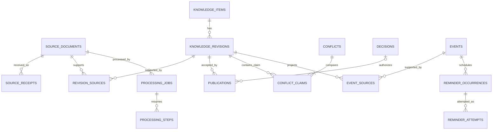

# Database Design

This is the conceptual PostgreSQL schema; it defines data ownership and constraints, not migration code. It conforms to [PROJECT_CONTEXT.md](../PROJECT_CONTEXT.md). Behaviour belongs to [DOCUMENT_RULES.md](DOCUMENT_RULES.md); transaction boundaries belong to [ARCHITECTURE.md](ARCHITECTURE.md).

## Design principles

PostgreSQL owns structured application/control data. Store IDs, metadata, typed factual projections, decisions and processing/delivery records. Do not store original files, images, full Markdown, embeddings, raw webhook payloads or permanent conversation history. A small JSON field is permitted for bounded typed metadata, never as a loophole for document/chat storage.

Use immutable identifiers, foreign keys, explicit enums/check constraints and UTC timestamps for instants. Preserve local dates, Asia/Kolkata timezone and known time precision for events. Unknown values are NULL, not fabricated defaults. Single-user operation needs a singleton profile/settings row, not users, tenants, invitations or roles for a public product.

Initial database hosting is Aiven Free PostgreSQL over verified authenticated public TLS. SQLAlchemy 2, Psycopg 3 and Alembic are the initial adapters/migration tooling; pool limits are configurable defaults owned by ARCHITECTURE. Store no conversation context: it exists only in bounded process memory. Model/provider identifiers and tuning values are versioned implementation configuration, not AI-editable policy constants.

## Core entities

| Entity | Important fields and ownership |
| --- | --- |
| assistant_profile | Singleton ID, permitted Telegram user/chat IDs, timezone, confirmed college/course/section context where supplied. Secrets are references, not values. |
| settings | Singleton configuration version, fixed reminder-policy version, model/schema versions, cache/context limits and deployment configuration references. Policy constants cannot become AI-editable settings. |
| source_documents | ID, Drive original file ID, content hash, original/generated filename, media type, byte count, canonical uploaded_at, source kind, evidenced issue date if known, classification and source integrity state. |
| source_receipts | Source ID, received_at, permitted Telegram transport identifiers and optional Drive caption-companion ID. No ordinary chat bodies. Tracks repeated uploads without duplicating sources. |
| knowledge_items | Stable ID, title, logical type and evidenced scope key. An item is not a page or a filename. |
| knowledge_revisions | ID, item ID, immutable revision number, Drive Markdown ID/hash, schema/extractor versions, lifecycle status, publication state, validity bounds, temporary flag and creation/acceptance metadata. |
| revision_sources | Revision/source IDs and structured locators, fact/section keys, evidence hashes and confidence/validation metadata. Supports multiple originals per revision. |
| revision_relations | From/to revision IDs, relation type (supersedes, amends, overrides), target scope/field selectors and effective window. |
| publications | Immutable ID, revision ID, control generation, accepted_at, prior control references, decision ID when applicable and outcome. Records atomic acceptance/reversal operations. |
| control_state | Singleton monotonic generation and configured current index-generation reference. Increment for eligibility-affecting mutations. |

Publication state is CANDIDATE, PUBLISHED or REJECTED. Candidate/rejected revisions have no effective lifecycle assignment; accepted revisions have one of ACTIVE, EXPIRED, ARCHIVED or CONFLICTED. This separation prevents “awaiting confirmation” from masquerading as ACTIVE. Metadata status in Drive is a creation-time snapshot only.

An intake-reserved source row may temporarily have no Drive ID/hash until source preservation completes; only a verified source may support publication. A receipt/job can therefore survive download/Drive failure without storing binary data in PostgreSQL. Confirmed missing/corrupt artifacts set an integrity hold in control metadata; the eligibility resolver rejects dependent facts until recovery.

## Decisions and conflicts

| Entity | Important fields and ownership |
| --- | --- |
| confirmations | ID, typed purpose, candidate/source/revision references, expected control versions, proposed structured operation, state (PENDING, RESOLVED, OBSOLETE), Telegram prompt reference. No conversation transcript. |
| decisions | Immutable ID, confirmation ID if any, decision type, selected values/scope, evidence/text-source references, decided_at, expected revision versions and superseded decision reference. |
| conflicts | ID, OPEN/RESOLVED state, involved revisions, logical scope, affected field keys, consequence class, detected_at and resolution decision ID. |
| conflict_claims | Conflict/revision/source references, field key and competing typed value; source locators remain linked through revision_sources. |

Store only the exact structured user outcome and accepted correction source. Do not persist all clarification replies. Partial conflict masks join through conflicts/field selectors; revisions remain ACTIVE for their undisputed content. A wholly disputed represented scope can be CONFLICTED. Record the affected event dependency when scheduling data becomes disputed.

## Structured schedules and events

| Entity | Important fields and ownership |
| --- | --- |
| timetable_entries | Accepted revision/source references, logical slot ID, section/term, weekday or explicit date, local start/end when known, subject, room, validity and provenance mapping. Stores recurring structured timetable information. |
| events | Stable logical event ID, event type, title, scope, local event date, known local times/UTC instants, precision, source revision references, active/cancelled control flags, timing schedule_revision and conflict dependencies. |
| event_sources | Event ID, field key, revision/source/decision reference and locator. Allows merged evidence without a single misleading source field. |
| reminder_occurrences | ID, event ID, schedule_revision, policy version, offset, due_at, expires_at, state, dependency/control references, send lease and confirmed Telegram message ID if available. |
| reminder_attempts | Occurrence ID, attempt number/time, sanitized result code, state and retry timing. No copied reminder body or chat text. |

Timetable recurrence remains deterministic. Derive occurrences on the requested local day from applicable entries and evidenced exceptions. Do not materialize an infinite calendar or invent academic-term boundaries. Exams and assignments/deadlines have explicit local dates; an unresolved date remains a candidate and cannot produce reminders.

Event types distinguish EXAM, ASSIGNMENT_DEADLINE, LECTURE and OTHER. Event lifecycle/eligibility follows referenced knowledge; a future event date does not imply future knowledge validity. Event projections carry enough provenance for deterministic answers while source bodies remain in Drive.

The schedule_revision changes when accepted scheduling facts change, not for a room spelling correction or index rebuild. This prevents reissuing the same offsets after non-timing edits. On a date/time change, cancel obsolete future occurrences and create eligible future offsets under the new schedule revision; retain previous sent history. Cancellation or conflicts suspend/cancel dependent unsent occurrences within the same control transaction.

Reminder states: PENDING, SUSPENDED, SENDING, SENT, SKIPPED, CANCELLED, UNKNOWN. Explicit transient failure can return SENDING to PENDING with next retry time; ambiguous send outcome becomes UNKNOWN. SKIPPED includes elapsed offsets and expired delivery windows. See DOCUMENT_RULES for time policy and ARCHITECTURE for unknown delivery handling.

## Processing and derived-state tracking

| Entity | Important fields and ownership |
| --- | --- |
| telegram_updates | Unique update ID, received_at, route category, processing/reference status. IDs enable deduplication without storing messages. |
| processing_jobs | ID, source/receipt ID, extractor/schema version, current stage, state, lease token/expiry, attempt count, sanitized error code, next retry and artifact references. |
| processing_steps | Job/stage/version key, result metadata/hash, Drive artifact ID and completion marker. No extracted full text bodies. |
| outbox | Unique operation key, job/entity ID, task kind, dispatch state, next retry and attempt count. Payload consists of internal references. |
| index_entries | Revision ID, model/version, dimensions, index generation/collection, chunk locator/hash and PENDING/READY/FAILED state. Does not store vectors. |
| audit_events | Timestamp, operation, internal object IDs, prior/new control state, decision/publication ID, correlation ID and safe reason code. No chat/document/provider payloads. |

Job states: QUEUED, RUNNING, WAITING_CONFIRMATION, RETRY_PENDING, SUCCEEDED, FAILED. Source preservation, extraction, validation, publication and indexing are explicit stages. A job can publish usable knowledge while indexing remains pending in separate derived-update work; a failed index update is not reported as a failed source upload.

Quota deferral uses RETRY_PENDING, sanitized reason QUOTA_EXHAUSTED and a next-attempt timestamp. Persist before acknowledging Cloud Tasks; the operational tick redispatches eligible work. Transport attempts and quota deferrals are distinguishable so waiting for free quota does not repeatedly consume the transient-error budget. Existing processing steps and publication records prevent repeated effects. No durable ordinary-question payload or paid-fallback state is introduced.

Initial engineering retention: seven days for minimal Telegram transport deduplication metadata and 30 days for sanitized operational logs. Persistent source/job/stage identity, decisions, publications and reminder delivery identity/history are separate and are not deleted by that cleanup. Terminal diagnostic detail may be compacted without removing idempotency or lineage. Routine questions keep only process-memory context; their bodies are never stored in these tables. Backup retention and recovery targets are owned by ARCHITECTURE.

## Relationships

## Constraints and indexes

- Unique Telegram update ID; unique content hash for canonical source bytes, with separate receipts; unique `(item_id, revision_number)`; unique Drive artifact IDs where each represents one revision.
- A temporary revision requires known `valid_from < valid_until`; all bounded intervals require ordered bounds. Scope identifiers must be supported or confirmed, not inferred from ungrounded defaults.
- Publication requires verified Drive artifact references, passing validation, complete required provenance and no unresolved blocking decision for the published facts.
- No universal uniqueness constraint on ACTIVE item alone: underlying and temporary/future revisions may coexist. Serialize effective-state updates per item/scope and validate overlap deterministically.
- Unique logical timetable occurrence key and event identity prevent duplicate extraction from producing multiple events. Never use title alone as event identity.
- Unique `(event_id, schedule_revision, policy_version, offset)` for reminders. Index claimable due states by next attempt/due time; use row locks and leases to handle concurrent checks.
- Unique `(job_id, stage, stage_version)` processing result and unique outbox operation key. A lease owner/version must match before committing a stage outcome.
- Foreign keys preserve evidence lineage; no cascading deletion of sources, revisions, decisions or sent reminder records as part of undo.
- Index scope/type/status/validity metadata for effective retrieval, event dates for structured queries, and open conflicts by item/field.

Some invariants cross rows/stores and require transactional application validation, not a SQL CHECK alone. In particular, Drive integrity and field-level effective applicability require the shared domain resolver.

## Atomic operations and recovery

Publication, conflict registration/resolution, expiry materialization and undo update affected control records, event projections, future reminder state, control generation and derived-work outbox together. Use optimistic expected-version checks plus row locks; re-evaluate stale candidates.

Do not hold a PostgreSQL transaction open during document parsing or Gemini extraction. External artifacts are staged before commit and reconciled by IDs/hashes afterward. Reminder send locking is a short bounded special case described in ARCHITECTURE.

Create schema in milestone dependency order: singleton/source/intake/job/outbox/audit records first; items/revisions/provenance and confirmations next; decisions/publications/conflicts plus schedule/event projections next; then index tracking and reminder execution details. Within each group, create referenced entities before their foreign keys. ROADMAP owns the implementation sequence.

Backup and restore must recover decisions and publication metadata alongside Drive content; file originals alone do not reproduce the user's accepted conflict resolutions. Rebuild event projections/index/cache and validate effective knowledge before enabling reminder delivery after restore.

Restored records may omit operations since the backup: reconcile source manifests, jobs and uncertain reminder delivery intervals before enabling effects. Do not blindly replay outbox records or treat restored PENDING reminders as proof they were never sent. Core recovery and free-quota-dependent index recovery are validated separately in TESTING.
