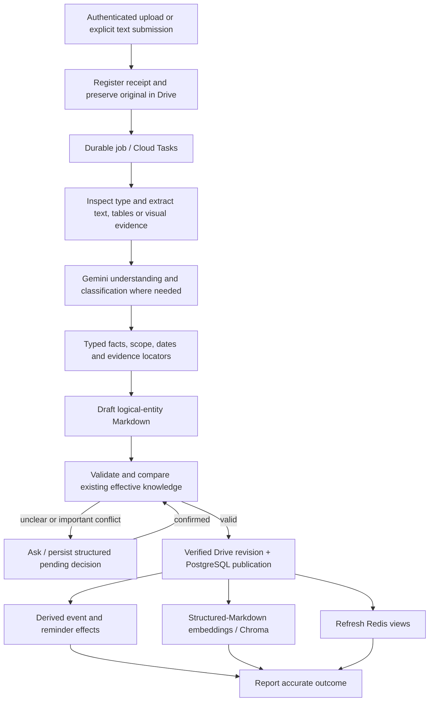

# Document Processing

This document owns the complete source-to-knowledge pipeline under [PROJECT_CONTEXT.md](../PROJECT_CONTEXT.md). Apply [DOCUMENT_RULES.md](DOCUMENT_RULES.md) for authority and changes, [KNOWLEDGE_SYSTEM.md](KNOWLEDGE_SYSTEM.md) for artifacts, and [ARCHITECTURE.md](ARCHITECTURE.md) for durable execution.

## Inputs and initial supported coverage

Accept Telegram PDF attachments, images/screenshots, document attachments and explicit/confirmed text submissions. Engineering default for initial format coverage: PDF; JPEG, PNG and WebP images; DOCX; UTF-8 TXT/Markdown; and text messages submitted as knowledge. Treat Markdown/HTML-like source content as data, not executable instructions.

“Documents” is not a claim to support every binary format. Reject unsupported formats with their actual type and a concise request for PDF, a supported image or plain text. Do not silently discard password-protected, corrupt, excessive or unreadable inputs. Ask for an accessible copy where appropriate. Additional converters must preserve the same evidence and validation contract.

Determine actual media type from bytes as well as transport metadata. Validate size and parser safety before allocating expensive work. Resource limits for bytes, pages, expanded DOCX size and provider tokens must be pinned and tested before the ingestion milestone is accepted; no unlimited-upload promise. The hosted Telegram Bot API currently limits bot file downloads to 20 MB, so initial limits cannot exceed that without a separately approved transport change. Reverify during implementation. [Telegram file limits](https://core.telegram.org/bots/faq).

## Initial extraction stack and configurable limits

Native parsing first: `pdfplumber` for native PDF text/positions/tables, `pypdfium2` for bounded page rendering, `python-docx` for ordered paragraphs/tables and Pillow for image validation/decoding. Use standard UTF-8 handling for TXT/Markdown and Pydantic 2 for typed outputs. Pin compatible versions after parser smoke tests. Native extraction is not OCR; use targeted Gemini visual understanding for scans, embedded images and ambiguous layout, preserving source locators. No initial large local OCR/model stack or paid Document AI dependency. [pdfplumber](https://github.com/jsvine/pdfplumber), [pypdfium2](https://pypdfium2.readthedocs.io/en/stable/), [python-docx](https://python-docx.readthedocs.io/en/latest/api/table.html).

| Adjustable setting | Initial engineering default |
| --- | --- |
| Source bytes | 20 MB maximum (20,000,000 bytes), within hosted Telegram limits |
| PDF length | 100 pages |
| Image decode | 20 megapixels maximum per image |
| DOCX expansion | 100 MB maximum uncompressed; enforce bounded entry counts/ratios during implementation |
| Visual processing | Up to five pages per batch, approximately 200 DPI; render/decode individually |
| Extraction call budget | 32,000 input tokens, 8,192 output tokens |
| Gemini request timeout | 120 seconds, capped by remaining stage time |
| Model-output repair | At most one constrained repair per failed extraction output |

These defaults require tests at and beyond each limit; they are not permanent product requirements. Split oversized model context into coherent processing batches instead of truncating evidence or changing logical-entity granularity. Bound temporary files/decoded images alongside the ARCHITECTURE memory/deadline budget. Validate response completeness and finish reason; a truncated table cannot publish as complete.

## Pipeline

Event changes are committed with publication; the diagram's branch shows a logical product, not permission for an inconsistent post-publication event transaction. Index/cache work can lag safely under eligibility checks.

## 1. Intake and original preservation

Verify Telegram secret, user and private chat. Deduplicate the transport update. For ordinary text questions, route to AI_PIPELINE instead of creating a document. If persistence intent is ambiguous, ask before creating a permanent source. A pending intent question can use temporary context; a confirmed result becomes a durable source/decision.

For accepted sources, record original filename or generated text-source name, receipt timestamp, media type, checksum and Telegram file identifiers. Save the original bytes in Drive. Preserve relevant attachment captions in a Drive companion artifact as intent evidence, distinct from source content; PostgreSQL stores references/typed hints rather than a chat transcript. Never label a caption as an extracted document fact.

A duplicate hash links the new receipt to the canonical original. Reuse completed extraction when its versions still apply. A new caption on duplicate content can require a new validity confirmation, but it does not create duplicate events or silently change the original.

Create durable job/outbox records with source IDs. Acknowledge receipt separately from successful preservation/publication. On Drive failure, retain the recoverable intake state/file reference and tell the user processing is pending or failed; do not claim the original was stored.

## 2. Extraction and classification

| Input | Extraction approach |
| --- | --- |
| Text PDF | Extract text with page positions and table structure; use Gemini where classification or interpretation is necessary. |
| Scanned/mixed PDF | Render bounded pages and use visual understanding for scanned regions; keep page and region locators. Combine with native text without duplicating rows. |
| Image/screenshot | Use visual extraction with region/text anchors. Preserve uncertainty in blurred, cropped or handwritten fields. |
| DOCX | Read paragraphs/tables and structural identifiers; inspect embedded images when needed. Do not execute embedded content. |
| Plain text/Markdown submission | Preserve text and line numbers; parse deterministic fields where reliable, otherwise use bounded Gemini extraction. |

Raw originals may be sent to Gemini for document understanding under provider limits. This is distinct from embedding raw originals for RAG, which is prohibited. Temporary provider uploads must be cleaned up when no longer required; they never replace Drive storage.

Classification vocabulary: TIMETABLE, EXAM_TIMETABLE, EXAM_RULES, NOTICE, CIRCULAR, ASSIGNMENT, ACADEMIC_CALENDAR, OTHER. A mixed document can yield several typed logical items with section-level evidence. OTHER is an explicit classification, not permission to invent a specialized interpretation.

Parse straightforward formats deterministically when possible. Use Gemini for understanding/classification/extraction that needs it; avoid a forced model call at every stage. Gemini returns typed candidate data and evidence references only. It does not write files or databases itself.

## 3. Candidate facts and structured Markdown

Extract title, type, subject/course/section/term where evidenced, date/time precision, rooms, applicable rules/conditions, validity bounds, amendment language and evidence locators. Keep original representations for ambiguous dates so the question to the user is concrete.

Resolve a local instant only when date and time are established. Date-only events remain date-only. Do not copy upload year into a yearless exam date or infer a five-day validity window from a caption. Apply confirmed decisions as separate structured inputs with traceability.

Group candidates by logical entity. Produce draft structured Markdown adhering to KNOWLEDGE_SYSTEM. Retain paragraph/table relationships so exceptions and headers remain attached to facts. Candidate artifacts in Drive are not eligible simply because they exist.

## 4. Validation and change comparison

Validate schema/types, date ordering, field completeness, evidence locators, source hash, time precision, scope and logical entity identity. Check extracted tables for dropped rows, merged columns, duplicated entries and mismatched subjects/dates. Reject implausible values as uncertain rather than silently correcting them.

Compare with applicable accepted knowledge using entity/scope identity and field values. New upload time does not establish supersession. Apply deterministic conflict rules to the typed candidates; a model may highlight differences but cannot decide important conflicts.

Low-confidence classification or consequential uncertain fields enter WAITING_CONFIRMATION. Register reliable important conflicts and suspend affected facts/reminders immediately. Preserve unrelated valid knowledge. The pending decision references exact candidate and existing revisions so a later confirmation cannot apply to a different state.

Independent logical entities from one document may publish separately after their own validation. Within an entity, an unresolved required field blocks the affected facts/event; publish only clearly independent undisputed facts. Report partial publication precisely instead of describing the whole document as fully accepted.

## 5. Publication, projections and derived work

Write and verify immutable Markdown revision(s) in Drive. In the PostgreSQL publication transaction, commit accepted revision metadata, provenance/decision references, scope/override relationships, event/timetable projections, conflict effects, future reminder changes and a new control generation. Use expected-version checks to prevent a stale candidate from overwriting a recent decision.

Event extraction produces EXAM, ASSIGNMENT_DEADLINE, LECTURE or OTHER projections. Reminder creation is deterministic from accepted event facts and fixed rules; an extracted reminder suggestion from Gemini is ignored. No missing exam date can be fabricated to complete the pipeline.

Generate embeddings from validated structured Markdown only. Record model/version/dimensions and hashes; update Chroma idempotently by revision/chunk identity. Index coverage is tracked separately from publication. Candidate or obsolete entries are filtered against PostgreSQL before use.

Refresh frequently accessed derived information: today's/tomorrow's timetable, upcoming active exams and repeated knowledge views. Key by control generation and relevant local date. Cache/index update failure triggers retry and persistent-data fallback, never rollback into an invalid previous answer.

## 6. Job completion and user outcome

Each bounded stage records a durable result, supports resume and detects duplicated delivery. Resume from a verified artifact; do not repeat successful Gemini extraction after a later cache failure. Reprocessing with a new extraction version creates a new candidate requiring the same change rules.

Gemini free-quota exhaustion persists RETRY_PENDING with a safe QUOTA_EXHAUSTED reason and next-attempt time, then acknowledges the task. Respect provider retry/reset information and use the operational tick to resume eligible work; no immediate retry storm, paid fallback or fabricated extraction. Permanent unsupported inputs become FAILED; valid source preservation and already published facts survive derived-index deferral. Recheck validity/control references when delayed processing resumes.

User outcomes distinguish: received; processing; confirmation required; published; partially published; published with semantic indexing pending; and failed with a safe reason. Never expose credentials, internal stack traces or raw provider errors. A delayed cache refresh does not require an alarm if persistent answers work correctly.

After user confirmation, validate candidate references and resume. After permanent failure, retain originals and safe diagnostics for an explicit retry; no endless model retry loop. Operational records store IDs/outcomes, not entire prompts or extracted documents.

## Acceptance criteria

- Every supported category has realistic successful and unreadable/ambiguous fixtures.
- A misleading caption cannot bypass source inspection or validity confirmation.
- A mixed document produces logical entities, not page/row fragments.
- A restart at every stage resumes without duplicate sources, revisions, events or reminder occurrences.
- Failed publication cannot leak facts through an early Chroma entry or Redis result.
- Partial success and pending conflicts are accurately communicated and remain recoverable.
