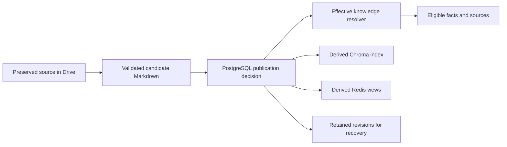

# Knowledge System

This document owns knowledge representation, provenance, storage granularity and retrieval eligibility under [PROJECT_CONTEXT.md](../PROJECT_CONTEXT.md). Lifecycle policy is owned by [DOCUMENT_RULES.md](DOCUMENT_RULES.md); storage mechanics by [ARCHITECTURE.md](ARCHITECTURE.md).

## Logical entities and structured files

A knowledge item represents a useful logical entity: one subject's exam, a timetable for a defined section/term, a coherent exam-rules topic, a notice or an assignment. An original can produce several items; an item can have several supporting sources. Do not create one file per PDF page, table row or arbitrary byte count. A single exam row may become an exam entity because of its meaning, not because it occupies a row.

Use stable internal item IDs and immutable revision IDs. Drive folders group originals, knowledge by type, archived revisions, backups and sanitized log exports. Folder paths and human filenames aid inspection; Drive file IDs and PostgreSQL records establish identity. A user never needs to maintain this organization.

Each revision is a complete human-readable Markdown artifact with schema-versioned metadata and structured sections. Keep related rows/tables together. If a very large logical item needs embedding chunks, split at semantic subsections within that item while retaining one logical identity and complete provenance. Embedding chunks are not additional page-based knowledge files.

## Markdown contract

| Required element | Contract |
| --- | --- |
| Identity | schema version, item ID, revision ID, title, classification/type and logical scope |
| State snapshot | publication state, lifecycle status if already assigned, and observed/expected control version at artifact creation |
| Sources | source IDs, Drive original file IDs, original filenames, upload timestamps and source locators |
| Validity | known bounds, temporary flag, scope/field targets and evidence or confirmed decision establishing them |
| Extracted facts | typed values in readable sections/tables; unknown values explicit rather than fabricated |
| Provenance | fact/section-to-source mapping, including multiple sources where applicable |
| Quality | extraction/schema version, unresolved uncertainties and validation outcome |
| Lineage | superseded/amended/overridden revisions and decision IDs where applicable |

Metadata can use YAML front matter; the body uses headings, labelled fields and tables. This is an implementation representation choice, not a new user-facing format requirement. Validators reject unsupported schema versions and invalid field types before publication.

Status in an immutable artifact is explicitly a snapshot. Current lifecycle, conflict masks and publication state always come from PostgreSQL. Moving files or refreshing metadata sidecars for human browsing is optional derived housekeeping and cannot change eligibility. Archive status must not depend on Drive folder moves succeeding.

A file staged before the publication transaction records CANDIDATE with an unset lifecycle status and expected control version. Do not label it ACTIVE in anticipation of a commit. Its later publication is recorded in PostgreSQL; this metadata snapshot is never used to select current knowledge. The required status information is retained without pretending that an immutable file can show a live database state.

Example content shape (illustrative values, not project knowledge):

```text
Title: Python Programming Exam
Item ID: <stable-id>
Revision ID: <revision-id>
Type: EXAM_TIMETABLE / exam event
State snapshot: CANDIDATE; lifecycle unset; expected control version <version>
Scope: <evidenced course, term, section>
Source: Exam_Timetable.pdf
Uploaded: <actual receipt timestamp>
Evidence: page 2, table "Semester Exams", Python row
Date: 15 October 2026
Time: 10:30 Asia/Kolkata
Room: C301
Validity: <evidenced or confirmed scope/window; unknown bounds explicit>
```

## Source traceability

Use page/table/row locators for PDFs, image region or visible text anchors for images, paragraph/table identifiers for documents and line ranges for text. Locators permit evidence review; they do not dictate knowledge-file granularity.

Every factual section and structured event field must map to evidence. A merged item retains all required source mappings. Never cite a convenient filename that does not support the specific claim. The upload date belongs to the source receipt; the creation date of the derived Markdown is different.

An explicit/confirmed text submission is preserved as a UTF-8 text source in Drive with a generated stable filename such as `text_submission_<id>.txt` and its actual submission time. Include only the accepted submission/correction, not surrounding dialogue. For a confirmed proposal, preserve the accepted text and decision outcome. The assistant cites that generated filename and date, identifying it as user-submitted knowledge when relevant.

## Persistent ownership and derived data

- Drive owns original bytes and structured Markdown content revisions.
- PostgreSQL owns identifiers, metadata, publication, decisions, effective-scope relationships, event projections and processing state. It does not duplicate full knowledge bodies.
- Chroma holds embeddings and minimum searchable structured-Markdown excerpts/metadata. It is replaceable and never authoritative for lifecycle or conflict resolution.
- Upstash Free Redis holds rebuildable derived views only. Temporary conversation context stays in bounded process memory. A cache hit cannot bypass PostgreSQL eligibility checks.

Treat event/timetable rows as queryable structured projections of accepted knowledge, not independent editorial truth. Their values and provenance must agree with the accepted revision and decision records. Rebuild them from the corresponding structured Markdown and control decisions when required.

## Effective knowledge selection

All retrieval paths call one deterministic eligibility contract:

1. Identify the query's entities/scope and relevant applicability time; obtain current time from the runtime clock.
2. Require a committed publication, current accepted control references, lifecycle ACTIVE and no source/artifact integrity hold.
3. Enforce validity and scope; reject EXPIRED, ARCHIVED and wholly CONFLICTED revisions.
4. Apply targeted conflict masks and temporary overrides from PostgreSQL.
5. Return eligible facts with revision IDs, source references, decision references and control generation.

Published ACTIVE revisions can coexist when they apply to different windows/scopes or one is a valid underlying base masked by an override. Never implement “one newest ACTIVE file wins.” Never use approximate vector similarity to choose authority.

Structured timetable queries select occurrences for the requested day; semantic rule questions select currently applicable rules unless a future scope/date is explicitly requested. Normal queries never search historical revisions just because the active result set is empty. Explicit undo/recovery can inspect retained evidence in a separate mode.

## Embeddings and retrieval

Generate embeddings only from validated structured Markdown. Initial configurable model: `gemini-embedding-2`, 768 dimensions, cosine similarity, text inputs only. Do not embed raw PDFs, OCR dumps, original document bytes, captions as standalone truth or conversation history. Embedding generation is an AI call; avoid it for known structured lookups. Free embedding-quota exhaustion defers derived indexing without invalidating accepted structured knowledge.

Embedding 2 uses retrieval instructions in the text input rather than the older `task_type` parameter and automatically normalizes reduced-dimensional outputs. Construct independent embeddings per semantic chunk; do not accidentally aggregate several items into one vector. Model ID, dimension, input formatting and schema version are configuration recorded per index generation. Changes require evaluation and a full compatible rebuild before switching collections. [Embedding guide](https://ai.google.dev/gemini-api/docs/embeddings).

Record embedding model/version, dimensionality, content hash, item/revision IDs, scope and chunk locator. Include enough coherent surrounding structured context to avoid separating exceptions from rules or table headings from values. Enforce model limits through semantic subdivisions; do not discard overflow silently.

Chroma results are candidates. Recheck their IDs and hashes against PostgreSQL, then fetch approved Markdown or verified cached content to construct context. For partially conflicted or overridden items, remove disputed/masked fields before the model sees answer context. Historical or ineligible excerpts cannot be passed through merely because their parent item has an ACTIVE revision.

Overfetch/filter or query eligible IDs to avoid obsolete hits consuming the entire candidate budget. A missing eligible index is an indexing gap, not proof that knowledge is absent. Use metadata-directed Drive retrieval when the relevant entity/topic can be identified. If reliable coverage cannot be established, state that lookup is unavailable or incomplete; do not claim that no rule exists.

## Lifecycle and rebuild



Index lifecycle: build pending entries from validated candidates, mark index coverage in PostgreSQL, and allow retrieval only after publication eligibility checks. Remove or filter obsolete entries; cleanup timing must not affect correctness. Do not delete original evidence to save index space.

Rebuild Chroma into a new collection from published Drive revisions plus PostgreSQL metadata. Validate hashes, coverage and representative queries before switching the configured collection pointer. Re-embed all applicable content when model/dimensions change; never mix incompatible vectors. Retain a rollback pointer until validation completes, then discard obsolete derived entries.

On e2-micro, benchmark rebuild overlap explicitly; retaining a disk rollback collection must not assume that both indexes can reside in RAM. A bounded rebuild may temporarily disable semantic retrieval while exact/structured paths remain available. No silent VM resize or unbounded embedding retries to complete recovery.

Rebuild Redis from PostgreSQL projections/Drive Markdown. Key views by scope, query date and control generation; cap validity at the next known transition. Invalidate on publication, resolution, expiry and undo. If an invalidation fails, generation/validity checks still reject stale results.

Initial derived-cache TTL is five minutes, adjustable after measurement and capped by the next relevant validity transition. Cache timeout/quota failure uses persistent fallback; persistence in Upstash does not change data ownership.

## Acceptance criteria

- Every published item can be traced to original evidence and any local decisions.
- Logical items survive reformatting/re-indexing without changing identity.
- Active-only retrieval excludes obsolete/conflicted facts through every path, including cache hits and partially masked Markdown.
- Loss of Redis or the entire Chroma collection cannot destroy accepted knowledge.
- Rebuilt projections reproduce the same effective answers as the pre-rebuild state.
