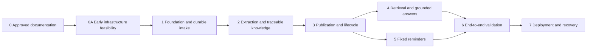

# Implementation Roadmap

This document defines implementation sequence, not product versions. [PROJECT_CONTEXT.md](../PROJECT_CONTEXT.md) and the detailed specifications govern behaviour. No application implementation is authorized merely by this roadmap. Each milestone requires its acceptance evidence before dependent work is considered complete.

## Dependency order

Implementation follows the numbered order by default. The dependency diagram permits bounded independent work only after shared policies/contracts are established; it is not a requirement to create parallel teams or services.

## 0. Specification baseline and implementation preparation

Dependencies: approved documentation plan and integrated root clarifications.

Deliver: the root and exactly ten owned-area specifications; shared terminology; conceptual data/interface contracts; scenario corpus plan; approved hosting/model/parser decisions and clearly labelled adjustable defaults.

Acceptance: review all eleven files together, confirm no contradictory product rules or unauthorized scope, validate links and coverage, and explicitly record any remaining assumptions. No application code during this documentation phase.

Before application implementation begins, translate the approved defaults into bounded tasks without changing policy. Exact dependency versions/image digests and measured adjustments are recorded in the owning docs. This documentation update does not authorize application code, live provisioning or benchmark execution.

## 0A. Early infrastructure feasibility gate

Dependencies: milestone 0 and subsequent authorization for implementation/feasibility work.

Test the approved private e2-micro Chroma deployment before building vector-dependent features or assuming production capacity. Use the selected minimal server/client versions, externally supplied 768-dimensional embeddings, representative logical Markdown and growth headroom. Measure idle/peak memory, CPU, query/insert latency, restart persistence and rebuild/rollback overlap; include TLS overhead and one ingestion stage at a time. No local embedding model, PostgreSQL or Redis on this VM.

Also measure stored backend/Chroma container footprint including deployment overlap against Artifact Registry's free allowance, and verify private image-pull/admin/update access without paid NAT or external VM IPv4. Verify account-level free-tier eligibility before any authorized provisioning.

Acceptance: evidence satisfies TESTING B-01/B-02 with recorded corpus, versions and headroom; no OOM or sustained swapping; persistence works and the proposed layout fits the zero-cost target. If Chroma or container feasibility fails, stop dependent infrastructure work, report evidence and obtain approval before a machine/cost/scope change. Independent policy/data-design work may continue without claiming this gate passed. Re-run capacity checks at milestone 7 with the completed corpus.

## 1. Foundation, authorization and durable intake

Dependencies: milestone 0 and milestone 0A feasibility acceptance for the deployment baseline.

Deliver: FastAPI modular boundaries; configuration/clock abstractions; Telegram user/chat/webhook verification; internal invocation authentication; PostgreSQL control/job/outbox foundation; Drive source storage and OAuth setup; Cloud Tasks adapter; sanitized observability. Local isolated service tooling is allowed during implementation, without provisioning production by assumption.

Acceptance: an authorized supported upload is preserved and recoverably queued; duplicate Telegram delivery creates one logical intake; failed enqueue is recovered from outbox; unauthorized access has no processing effects. Ordinary questions are not persisted as source documents. No false “stored/published” acknowledgement after a failed write.

Validation: authorization tests, source-hash tests, Drive/database interruption cases, task lease/idempotency tests and inspection for secret/chat leakage. Confirm the intended Drive credentials can create/read app-owned files and refresh successfully.

## 2. Extraction and traceable structured knowledge

Dependencies: milestone 1 and pinned initial input/provider limits.

Deliver: supported PDF/image/DOCX/text adapters, bounded Gemini understanding/classification, typed candidate facts, evidence locators, logical-entity Markdown generation and schema/field validation. Include clear/ambiguous text-persistence routing and clarification records. Outputs remain candidates until publication policy exists.

Acceptance: each supported format yields expected traceable candidates or specific clarification/failure; tables and scans retain meaning; captions cannot silently set unsupported validity; unknown fields remain unknown. No raw-original embeddings and no page-based knowledge files.

Validation: P-01–P-05, P-09–P-11/P-14 and candidate extraction review. Resume after stage interruption without repeating already verified artifacts unnecessarily.

## 3. Publication, conflicts, temporary validity and recovery

Dependencies: milestone 2.

Deliver: the shared effective-knowledge resolver; PostgreSQL publication transactions; event/timetable projections; revisions/relations; partial conflict masks; confirmations; temporary overrides; expiry and undo; derived-update outbox and control generation. Build reminder dependency records now so milestone 5 cannot bypass conflicts.

Acceptance: important conflicts suspend affected facts; unrelated facts survive; exact confirmed validity applies; expiry restores only currently valid knowledge; future events are queryable before occurrence; stale confirmation/publication attempts are re-evaluated. Failed external writes cannot activate a candidate. Undo retains evidence and decision history.

Validation: U-01–U-11, P-06–P-08/P-12–P-13 and concurrent/partial-failure transaction tests. Compare event projections to accepted Markdown/provenance.

## 4. Retrieval, caching and grounded answers

Dependencies: milestone 3 and passed milestone 0A Chroma feasibility gate.

Deliver: deterministic event/timetable routes, Chroma indexing from structured Markdown, index coverage tracking, Upstash derived views, metadata-directed fallback, context construction, bounded free-tier Gemini responses, source attribution and response validation. Add bounded process-memory conversation context with expiry and honest loss/clarification handling. Test free-quota degradation without paid fallback.

Acceptance: clear structured queries use no Gemini calls; college answers cite actual originals/upload dates; stale/unpublished/conflicted facts cannot leak through any path; missing information results in clarification/abstention. Redis loss preserves answer correctness; Chroma outage does not disable structured queries. General explanations do not become persistent college facts.

Validation: full retrieval/grounding corpus, stale-index/cache and partial-mask tests, model-call counts, context expiry/privacy checks, index rebuild comparison and representative answer review.

## 5. Deterministic fixed reminders

Dependencies: milestone 3; use milestone 4's shared attribution/Telegram rendering facilities where applicable.

Deliver: fixed offset generation, event timing revisions, PostgreSQL delivery claims/attempts, minute-based Scheduler trigger, conflict/expiry revalidation, safe retries and UNKNOWN delivery reporting. No Gemini in execution.

Acceptance: all reminder clock cases R-01–R-15 pass; no post-event sends, backfilled elapsed offsets or duplicates from repeated Scheduler calls. Changes/conflicts cancel or suspend dependent unsent work; sent history is preserved. Ambiguous Telegram outcomes are not represented as guaranteed delivery.

Validation: clock-boundary, retry/timeout, concurrent Scheduler and event-change-versus-send tests. Verify source attribution and single-chat destination on every reminder.

## 6. End-to-end quality and failure validation

Dependencies: milestones 4 and 5.

Deliver: integrated scenario suite, real-provider extraction/answer evaluation, security/privacy inspection, recovery/rebuild tooling and measured resource/latency results.

Acceptance: TESTING's critical finite-suite accuracy gates pass; supported source types, conflicts, overrides, undo, outage fallbacks and reminders work together. Record known limits and coverage honestly. Verify no permanent chat store or incidental payload logging.

Validation: inject failures at each external-write boundary, restore isolated backups, compare regenerated effective knowledge and index answers, inspect scope boundaries and review every critical model output against source evidence.

## 7. Deployment, operational readiness and handover

Dependencies: milestone 6; measured approved hosting/defaults and passed benchmark/calibration gates B-01–B-08.

Deliver: Cloud Run and persistent Chroma e2-micro VM in us-central1, private connectivity, Secret Manager, authenticated Tasks/Scheduler, required database/cache endpoints, backup schedule and operational run instructions maintained in ARCHITECTURE. Do not add a separate runbook file without a new architectural reason.

Acceptance: representative corpus fits the approved VM with measured memory/headroom and acceptable recorded latency; capacity shortfall is escalated for user decision rather than silently resizing. Validate actual free-tier eligibility and total cost before provisioning. Internal routes, Telegram identity, OAuth refresh, stage deadlines and rate-limit handling pass live smoke checks.

Perform a restore/rebuild drill with reminder delivery disabled until effective state is validated. Confirm logs expose job/index/reminder failures without content or secrets. Document known service limits and how to retry failed jobs or inspect UNKNOWN reminder outcomes.

## Approved defaults, remaining measurements and change control

| Selection | Owner and deadline |
| --- | --- |
| Chroma and container feasibility | TESTING / ARCHITECTURE, milestone 0A before vector-dependent implementation; recheck at milestone 7 |
| Approved parser/model defaults; exact compatible packages/images and tested limits | DOCUMENT_PROCESSING / AI_PIPELINE / KNOWLEDGE_SYSTEM, before milestones 2/4 acceptance |
| Evidence-gated extraction; calibrated numeric classification/retrieval thresholds | TESTING with DOCUMENT_RULES / AI_BEHAVIOR, before milestones 2/4 acceptance |
| Aiven Free / Upstash Free public verified TLS; private Chroma; zero-cost target | ARCHITECTURE, approved choices; validate database behaviour, current quotas/networking and total footprint before deployment |
| Approved backup/retention defaults and recovery targets | ARCHITECTURE / DATABASE_DESIGN, validate storage and restore at milestone 6, recheck before milestone 7 |
| Cloud Run sizing, extraction/retrieval quality, quota consumption | TESTING B-03–B-07; tune configurable defaults from results |

Major services and initial engineering defaults are approved; their compatibility, capacity and quality are not yet proven. Gemini/provider/model identifiers, dimensions, limits, retries, TTLs and backup targets remain configuration, while Gemini-only/free-only policy and fixed product rules remain binding. No paid fallback or silent plan upgrade. If feasibility conflicts with the root, obtain approval and update PROJECT_CONTEXT.md and affected detailed specifications together.
